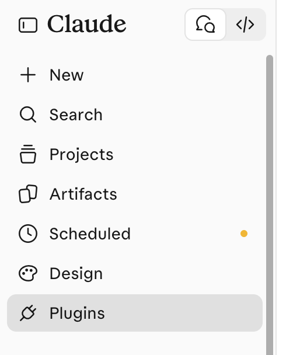
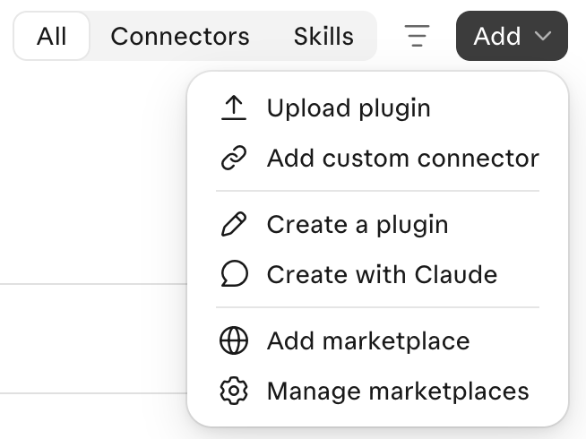
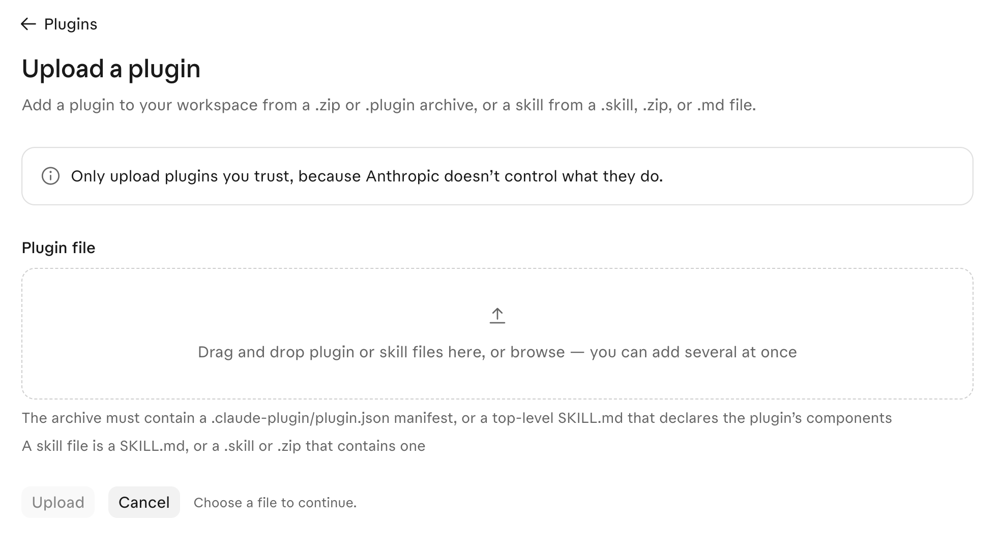
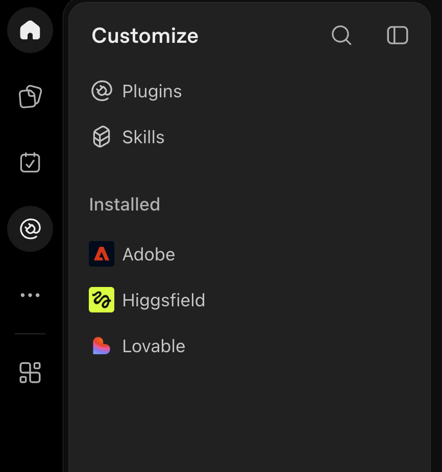
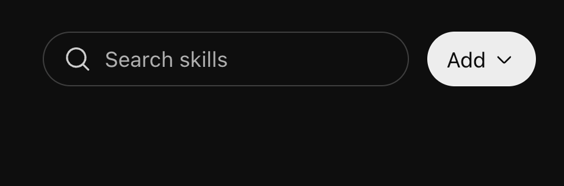
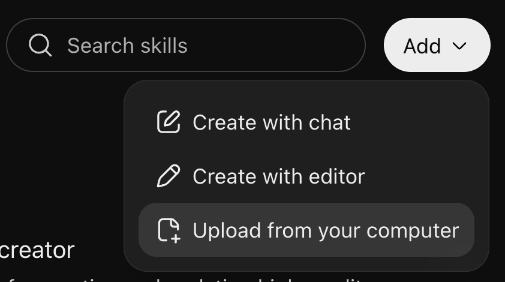
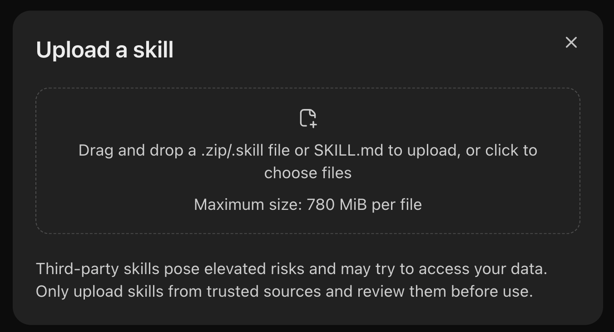

# kr-font-skill

**AI 티 안 나는 상업용 무료 한글 폰트, AI에게 찾아 달라고 하세요.**

AI한테 폰트를 물어보면 늘 주아체, 도현체 같은 비슷한 폰트만 나오죠. 이 스킬을 넣어 두면 Claude나 ChatGPT가

- 브랜드 분위기에 맞는 **상업용 무료** 폰트를 실제 폰트 사이트(눈누, 산돌구름, Google Fonts 등)에서 찾아오고
- 후보를 **실제 글씨체로 보여 주는 보드**를 만들어 주고
- 로고, 웹사이트, 포장지 등 **어디까지 써도 되는지** 라이선스를 확인해 줘요.

코딩을 몰라도 괜찮아요. 파일 몇 개만 올리면 됩니다.

---

## 이런 걸 할 수 있어요

| 이렇게 말하면                                             | 이렇게 해 줘요                                                               |
| --------------------------------------------------------- | ---------------------------------------------------------------------------- |
| "레트로하지만 고급스러운 카페 브랜드 폰트 찾아줘, 한글만" | 분위기별 후보 폰트를 찾아 보드로 보여 주고, 고르면 받는 곳과 라이선스를 정리 |
| (사진을 올리고) "이 글씨랑 비슷한 무료 폰트 찾아줘"       | 비슷한 무료 폰트를 원본과 나란히 비교                                        |
| "우리 사이트에 쓴 폰트 라이선스 괜찮은지 봐줘"            | 쓰인 폰트를 찾아 문제될 만한 부분을 알려 줌                                  |
| "홈페이지 한글 폰트가 너무 무거워"                        | 폰트 용량을 줄이는 방법을 적용 (개발자용)                                    |

---

## 설치하기

쓰는 AI에 맞는 방법 하나만 따라 하세요.

- [Claude (claude.ai 웹, 데스크톱 앱, 모바일)](#claude에-넣기) ← 가장 추천
- [ChatGPT](#chatgpt에-넣기)
- [개발자라면 (Claude Code, Codex 등)](#개발자용-설치)

---

## Claude에 넣기

> 필요한 것: Claude 계정 (무료 요금제도 가능)
> 걸리는 시간: 5분

### 1. 플러그인 파일 받기

아래 링크를 눌러 다운로드하세요. **압축을 풀지 말고 zip 그대로** 두세요. 스킬 4개가 한 파일에 다 들어 있어요.

- [kr-font-skill-plugin.zip](https://github.com/lilykwon/kr-font-skill/raw/main/dist/kr-font-skill-plugin.zip)

### 2. 플러그인 올리기

1. claude.ai 왼쪽 메뉴에서 **Plugins**를 눌러요.
   
2. 오른쪽 위 **Add**를 누르고 **Upload plugin**을 골라요.
   
3. 1번에서 받은 `kr-font-skill-plugin.zip`을 점선 상자에 끌어다 놓거나 눌러서 고른 뒤, 왼쪽 아래 **Upload**를 눌러요.
   

### 3. 설치 확인

플러그인 목록에 **kr-font-skill**이 보이고 켜져 있으면 끝이에요.

### 4. 써 보기

새 대화를 열고 이렇게 말해 보세요.

> 레트로하지만 고급스러운 카페 브랜드 폰트 찾아줘, 한글만

후보 폰트가 실제 글씨체로 그려진 보드가 대화 안에 나타나요. 마음에 드는 카드를 눌러 고르면 돼요.

**잘 안 될 때**

- 스킬이 안 불리는 것 같으면 "/font-research 스킬로 찾아줘"처럼 이름을 같이 말해 보세요.
- **Settings > Capabilities**에서 코드 실행과 파일 만들기(Code execution and file creation)가 꺼져 있으면 보드가 안 나올 수 있어요. 켜 주세요.
- 일부 폰트는 Claude가 직접 받지 못해서 **공식 다운로드 링크**로 알려 줘요. 링크를 눌러 직접 받으면 돼요.

<details>
<summary>Plugins 메뉴가 없다면: 스킬로 하나씩 넣기</summary>
1. 아래 zip을 받아요 (압축 풀지 않기). 폰트 찾기만 쓸 거면 `font-research.zip` 하나면 돼요.
   - [font-research.zip](https://github.com/lilykwon/kr-font-skill/raw/main/dist/font-research.zip)
   - [font-alternatives.zip](https://github.com/lilykwon/kr-font-skill/raw/main/dist/font-alternatives.zip)
   - [font-license-audit.zip](https://github.com/lilykwon/kr-font-skill/raw/main/dist/font-license-audit.zip)
   - [korean-webfont-optimize.zip](https://github.com/lilykwon/kr-font-skill/raw/main/dist/korean-webfont-optimize.zip)
2. **Settings > Capabilities**에서 코드 실행과 파일 만들기를 켜요.
3. **Customize > Skills**에서 `+` > **Upload a skill**로 zip을 하나씩 올려요.
</details>

---

## ChatGPT에 넣기

> 필요한 것: ChatGPT 계정 (프로젝트 기능을 쓸 수 있는 요금제)
> 걸리는 시간: 5분

ChatGPT는 아직 이 스킬을 바로 설치하는 기능이 없어서, **프로젝트**에 스킬 파일을 넣어 두고 쓰는 방식이에요.

### 1. 파일 받기

아래 링크를 눌러 다운로드하세요. **압축을 풀지 말고 zip 그대로** 두세요. Claude와 같은 파일이고, 스킬 4개가 한 파일에 다 들어 있어요.

- [kr-font-skill-plugin.zip](https://github.com/lilykwon/kr-font-skill/raw/main/dist/kr-font-skill-plugin.zip)

### 2. Skills 화면 열기

왼쪽 아이콘 줄에서 **Customize** 아이콘을 누르고 **Skills**를 골라요.


### 3. 스킬 올리기
 
1. 오른쪽 위 **Add**를 눌러요.

2. **Upload from your computer**를 골라요.

3. 1번에서 받은 `kr-font-skill-plugin.zip`을 점선 상자에 끌어다 놓거나 눌러서 골라요.

### 4. 써 보기
 
새 대화를 열고 이렇게 말해 보세요. 웹 검색이 켜져 있어야 실제 폰트 사이트를 찾아봐요.
 
> 레트로하지만 고급스러운 카페 브랜드 폰트 찾아줘, 한글만
 
보드가 HTML 파일로 오면, 받은 파일을 더블클릭해서 브라우저로 열어 보세요.
 
**잘 안 될 때**
- 스킬이 안 불리는 것 같으면 "font-research 스킬로 찾아줘"처럼 이름을 같이 말해 보세요.
<details>
<summary>Skills 메뉴가 없다면: 프로젝트에 넣어 쓰기</summary>
1. 아래 파일을 받아요. (글자만 잔뜩 나오면 화면에서 오른쪽 클릭 > **다른 이름으로 저장**)
   - [font-research.md](https://github.com/lilykwon/kr-font-skill/raw/main/dist/chatgpt/font-research.md)
   - [font-alternatives.md](https://github.com/lilykwon/kr-font-skill/raw/main/dist/chatgpt/font-alternatives.md)
   - [font-license-audit.md](https://github.com/lilykwon/kr-font-skill/raw/main/dist/chatgpt/font-license-audit.md)
   - [korean-webfont-optimize.md](https://github.com/lilykwon/kr-font-skill/raw/main/dist/chatgpt/korean-webfont-optimize.md)
2. 새 **프로젝트**를 만들고 받은 파일을 프로젝트 파일로 올려요.
3. 프로젝트 지침에 아래 문장을 붙여 넣어요.

```
폰트를 찾거나, 비슷한 폰트를 찾거나, 폰트 라이선스나 웹폰트에 대한 요청이 오면
프로젝트 파일 중 알맞은 .md 파일의 지침을 처음부터 끝까지 그대로 따를 것.
폰트 후보는 기억이 아니라 웹 검색으로 실제 폰트 사이트를 확인해서 찾을 것.
후보를 보여 줄 때는 각 폰트로 문구를 렌더링한 HTML 보드 파일을 만들어 줄 것.
```

### 5. 써 보기

그 프로젝트 안에서 새 대화를 열고 요청하세요. **웹 검색**이 켜져 있어야 실제 폰트 사이트를 찾아봐요.

> 레트로하지만 고급스러운 카페 브랜드 폰트 찾아줘, 한글만

보드는 HTML 파일로 받게 돼요. 받은 파일을 더블클릭하면 브라우저에서 열려요.

---

## 꼭 알아 두세요

- **법률 자문이 아니에요.** 로고를 만들거나 상표를 등록하기 전에는 폰트 배포처의 최신 약관을 꼭 직접 확인하세요.
- **폰트 파일은 들어 있지 않아요.** 스킬은 폰트를 찾고 확인하는 방법만 담고 있고, 폰트는 각 배포처에서 받아요.
- **본문용 기본 폰트는 그대로 써요.** Pretendard, Noto Sans KR 같은 폰트는 본문용으로 추천하고, 개성이 필요한 제목과 로고용 폰트를 새로 찾아 줘요.
- **AI가 자주 쓰는 폰트는 빼요.** 주아체, 도현체, G마켓 산스 등은 직접 요청하지 않으면 후보에 넣지 않아요.

---

## 개발자용 설치

<details>
<summary>Claude Code, Codex, Cursor 등에서 쓰기</summary>

**한 줄 설치 (여러 AI 코딩 도구 공통)**

```
npx skills add lilykwon/kr-font-skill
```

**Claude Code 플러그인**

```
/plugin marketplace add lilykwon/kr-font-skill
/plugin install kr-font-skill@kr-font-skill
```

**Codex에 직접 복사**

```
git clone https://github.com/lilykwon/kr-font-skill.git
mkdir -p ~/.codex/skills
cp -r kr-font-skill/plugins/kr-font-skill/skills/* ~/.codex/skills/
```

Codex를 다시 시작하고 `/skills` 로 확인하세요.

- 보드는 `fonts/board.html` 파일로 만들어져요.
- 같은 폰트만 반복 추천하지 않도록 `~/.claude/font-research/history.md` 에 기록을 남겨요.

</details>

---

만든 사람: [Lilly](https://github.com/lilykwon), 스킬 텍스트는 MIT 라이선스
